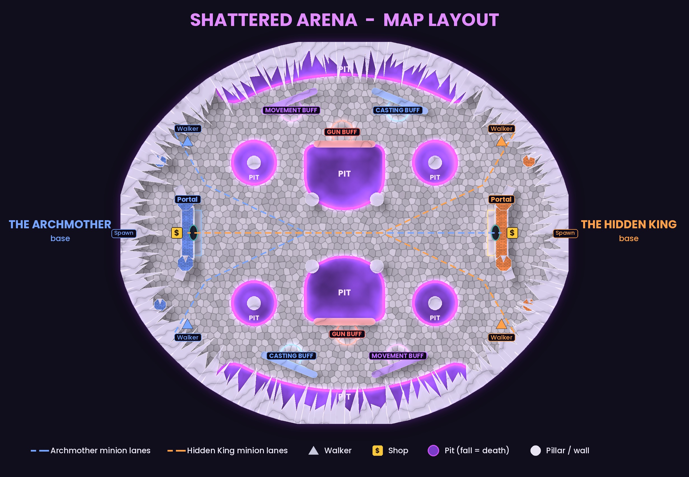

# Shattered Arena

A team arena mode for Deadlock, inspired by the Corrupted Arena limited-time mode from SMITE. Two teams, The Hidden King and The Archmother, fight on a custom map with bottomless pits. The first team to run out of tickets loses.

Built with [Modlock](https://github.com/paralin/modlock) in TypeScript. Playable on [Hyperline](https://hyperline.gg/play).

## How it plays

- **Tickets:** each team starts with 500 (the host can set 100 to 2,000). A hero death costs 5, a minion death costs its own team 1, and a minion walking into the enemy portal costs that team 1.
- **Pits:** fall into one and you die. The last enemy who hit you in the last 6 seconds gets the kill. The long pits along the outer wall stop just outside the Walkers' reach.
- **Heavy melee knockback:** an enemy's heavy melee pushes you the way they face and empties your stamina. Use it to throw people into pits.
- **Minions:** waves every 30 seconds from each base, walking to the enemy portal and fighting on the way.
- **Rift minions:** every 10 enemy deaths, a team sends 5 big, tough rift minions down the middle. Each one that gets in costs the enemy 2 tickets.
- **Camps:** six jungle camps, each a single tough creature (the game's tier 3) in the middle of the camp. Clearing one drops a real bridge buff (casting, gun or movement), taken with heavy melee.
- **Shared souls:** minion and hero kill souls pay the whole team the same.
- **Bonus round:** when a team wins, both teams go to a separate arena for a last-team-standing fight (no respawns, no ultimates). It can be turned off.
- **Host settings** on the team select screen, which everyone can see but only the host can change: tickets, respawn time, souls gain, starting souls and knockback strength, plus switches for:
  - **Random Heroes:** everyone gets a random hero instead of picking.
  - **Allow Duplicate Characters:** the same hero can be on a team more than once.
  - **Bonus Round:** on or off.
  - **Randomize Teams:** everyone is shuffled into two even teams before the hero pick.
- **Fair play:** no console cheats (`noclip`, `god` and the rest are refused) and no changing hero mid-match, from the console or the pause menu.
- **The screen in a match:** the mod's own top bar (each hero in their team's colour, greyed with a respawn timer while dead, with a dot that lights gold when their ultimate is ready, and the clock and tickets in the middle) and, bottom right, each team's progress to its next rift minions.

Match flow: team select, then everyone picks a hero at once (no hero twice on a team unless the host allows it) or gets a random one, a short intro, the match, then a results screen with the match length, each player's stats, hero and items, and whether your team won the bonus round.

## Building and running

You need [Modlock](https://github.com/paralin/modlock) and Deadlock.

1. Copy `maps/hl_arena_pit.vpk` into Deadlock's `game/citadel/maps/` folder (for local testing).
2. In this folder, run `modlock dev`. It builds the mod, starts a local server, launches Deadlock and joins.
3. `modlock build` only builds, into `build/`.

The compiled map ships with the mod: `modlock publish` uploads `maps/hl_arena_pit.vpk` along with the code. The portal effects in `content/` ship the same way, as the mod's own addon that every player's game loads.

If you also play through Hyperline's desktop app, quit it fully before running `modlock dev`: while it's open it replaces Modlock's interface drawing in your game, and the mod's screens don't show locally.

## Files

The code is grouped by what it's about. `main.ts` (the entry point, which wires everything up) and `config.ts` (every setting and number in one place) stay at the top.

| Folder | File | What it does |
|---|---|---|
| `match/` | `match.ts` | Team select, hero pick, match start and end, host settings |
| | `bots.ts` | Test bots |
| | `stats.ts` | Each player's stats for the results card |
| `rules/` | `tickets.ts` | Team tickets and pit kills |
| | `souls.ts` | Shared team souls |
| | `knockback.ts` | Heavy melee knockback |
| | `lockdown.ts` | No cheats and no hero or team changes mid-match |
| `arena/` | `layout.ts` | Map positions (generated by `tools/build_arena_v1.py`) |
| | `minions.ts` | Minion waves and rift minions |
| | `camps.ts` | Jungle camps and bridge buffs |
| | `base.ts` | Base healing and burning, indestructible Walkers |
| | `shops.ts`, `patrons.ts` | Shops and the Patron decorations |
| | `rift.ts` | The portals' Unstable Rift effects |
| `bonus/` | `bonus.ts` | The bonus round |
| `screen/` | `hud.tsx` | All on-screen interfaces |
| | `cinema.ts`, `lobbycam.ts` | Camera shots and the team-select camera |
| `maps/` | `hl_arena_pit.vpk` | The compiled map |
| `content/` | `particles/` | The compiled portal effects, shipped to players |
| `tools/` | | The map generator and helper scripts (see `tools/README.md`) |

## The map

`hl_arena_pit` is generated by Python scripts rather than drawn by hand: `tools/arena_shapes.py` holds every shape, and `tools/build_arena_v1.py` builds the Hammer map and `arena/layout.ts` from it. It's compiled with Modlock Tools (`tools/compile_arena.cmd`). The portal effects are enlarged copies of Deadlock's Unstable Rift: their sources are in `tools/rift/src/`, and `tools/compile_rift.cmd` compiles them into `content/particles/`.

## License

[MIT](LICENSE). Free to use, change and share, including in apps like Hideout and Hyperline, as long as you credit CosmicCapt.

Deadlock and its assets (models, materials, the effects the portals are copied from) belong to Valve and aren't covered by this license.
